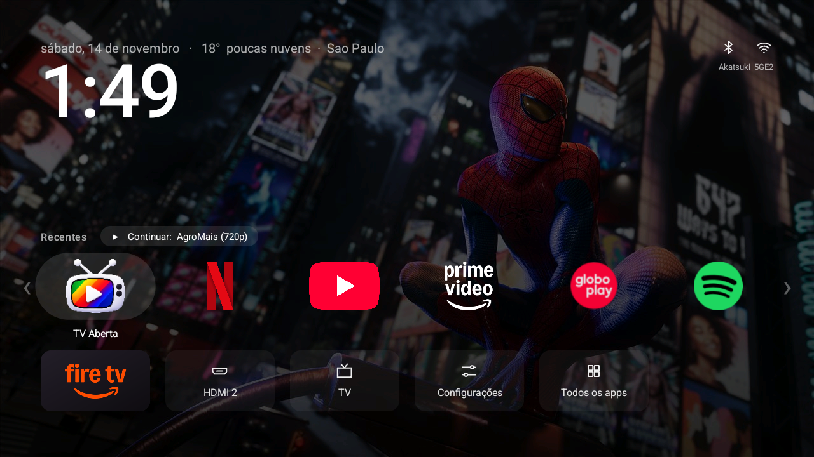

<p align="center"></p>

<h1 align="center">TV Aberta</h1>
<p align="center"><b>Sua TV, de graça!</b> Canais abertos e gratuitos para Android TV e celular Android, leve e feito para o controle remoto e para o toque.</p>

<p align="center"><a href="https://github.com/anthonymb1204/tv-aberta/releases/latest"><b>⬇ Baixar a versão mais nova (APK)</b></a></p>


## O que faz

- **Mais de 500 canais gratuitos em português** (o número muda conforme os canais que estão no ar), com os grandes primeiro:
  - **Abertas nacionais:** SBT, Record, Band, RedeTV!, TV Cultura, TV Brasil, TV Gazeta, e a Globo pelo Globoplay.
  - **Jornalismo:** CNN Brasil, Jovem Pan News, BandNews, Record News, SBT News, BM&C News, VEJA+.
  - **TVs regionais, educativas, legislativas, religiosas e comunitárias** de todo o Brasil.
  - **Pluto TV Brasil inteiro (185 canais):** filmes, séries, novelas, anime, Nickelodeon, MTV, reality, esportes, documentários.
  - **Esportes oficiais gratuitos:** FIFA+, Red Bull TV, NBA TV, UFC, WWE.
  - **Canais do YouTube que transmitem ao vivo de graça:** CazéTV, Canal GOAT, Xsports, N Sports, SportyNet, TNT Sports Brasil, CBF TV, Kings League Brasil, Time Brasil TV, Paulistão, Desimpedidos e Jovem Pan Esportes; e, no jornalismo, Jovem Pan News, CNN Brasil, SBT News, Record News, Band Jornalismo e UOL. Os que estão ao vivo sobem para o topo com **● AO VIVO** e o título da transmissão; OK abre a live no app do YouTube (ou a página do canal, se não houver live).
  - **Portugal:** RTP, SIC, TVI, Porto Canal, ARTV e outros canais portugueses com transmissão oficial gratuita.
  - **Mundo:** canais estrangeiros gratuitos (Euronews, CGTN, NHK World, Das Erste, La 1, TV5 Monde...).
  - **Notícias internacionais:** BBC, CNN International, DW, France 24, Al Jazeera.
- **Categorias:** ★ Favoritos, Brasil, Notícias, Esportes, Filmes, Séries, Novelas, Infantil, Anime, Documentários, Entretenimento, Música, Portugal, Mundo e Todos.
- **Sem repetidos:** quando várias listas trazem o mesmo canal, aparece uma vez só, na melhor qualidade que estiver no ar.
- **★ Favoritos:** segure OK (ou aperte Menu) num canal.
- **Volta no último canal** sozinho ao abrir. Voltar mostra a lista.
- **Logos e números:** os canais têm logo e número. Digitar o número no controle pula para o canal, na lista e no player.
- **Busca** que ignora acentos: digitar uma letra no controle já leva à busca.
- **Player nativo do Android** (VideoView), com ↑/↓ ou Canal +/- para trocar. Em chips MediaTek, o VLC fica sem som; o player nativo, não.
- **Esconde os canais fora do ar.** Ao abrir uma categoria, o app testa os canais em segundo plano e tira da lista os que não respondem; o topo mostra quantos ("Brasil · 39 canais · 7 fora do ar"). Um canal no ar é testado de novo depois de 6 horas; um fora do ar, depois de 1 hora, já que muitos voltam.
- **Leve:** um APK de ~330 KB, sem bibliotecas, feito para TVs com 1 GB de RAM.

| Logos e números | Favoritos |
|---|---|
|  |  |

## No celular

O mesmo APK funciona no celular Android: o app percebe sozinho se está numa TV ou num celular.

- **Lista em pé:** busca, categorias em botões que rolam para o lado e a lista de canais. Toque para assistir; toque e segure para favoritar.
- **Player deitado, em tela cheia.** Um toque mostra os controles, que somem sozinhos:
  - em cima, ‹ voltar, o nome do canal com **● AO VIVO** e o botão de transmitir;
  - **brilho** à esquerda e **volume** à direita (arraste na barra);
  - no meio, ⏮ ⏸ ⏭ (canal anterior, pausa, próximo canal); deslizar para cima ou para baixo também troca de canal;
  - embaixo, **Bloquear**: trava a tela para as crianças (sem controles, sem trocar de canal, Voltar e teclas de volume bloqueados). Para destravar, toque na tela e segure o cadeado por 1 segundo.
- **Transmitir para a TV (Google Cast):** o botão de transmitir lista as TVs com Chromecast da rede e abre o canal nelas; os botões do celular passam a controlar a TV. O app fala o protocolo do Cast direto (`CastClient.java`), sem as bibliotecas do Google. Canais em H.265 ou cujo servidor bloqueia acesso de outros sites (CORS) não podem ser transmitidos; para TVs sem Chromecast há o **Espelhar tela** do próprio celular.

## De onde vêm os canais

- **Listas públicas e gratuitas:**
  - [iptv-org](https://github.com/iptv-org/iptv): todos os canais do Brasil e todos os canais em português, além dos grandes internacionais;
  - [iptv-com](https://github.com/iptv-com/iptv) e [Free-TV](https://github.com/Free-TV/IPTV): mais canais abertos do Brasil e de Portugal;
  - Pluto TV Brasil, direto do Pluto (`Pluto.java`): cada aparelho abre a própria sessão e lê a grade e as categorias do Pluto. A sessão é pedida no formato que o player do Android toca (áudio e vídeo juntos); os links do Pluto que as listas públicas trazem mandam áudio e vídeo separados e ficam com a tela preta, por isso são ignorados. Favoritos e o último canal são guardados pelo código fixo do canal, já que os links mudam todo dia;
  - [M3UPT](https://github.com/LITUATUI/M3UPT): canais de TV de Portugal (só o grupo "TV", sem rádios e câmeras).
- **Cache:** as listas ficam guardadas por **12 horas**. Sem internet, o app usa a última lista salva.
- **Ficam de fora:**
  - canais marcados como **[Geo-blocked]**;
  - canais que usam **#KODIPROP** (DRM);
  - **canais pagos** (do Brasil e de Portugal) que só aparecem como retransmissão não oficial (Globo, ESPN, SporTV, Telecine, AXN, Sport TV...).
- **Cabeçalhos:** o app envia o **Referer** e o **User-Agent** das linhas `#EXTVLCOPT` quando o canal pede.

As fontes, as categorias, a ordem ("famosos" primeiro) e os filtros estão em `Channels.java`: `pool()`, `FAME`, `FOREIGN`, `PAY_TV` e `PAY_TV_PT`.

### Adicionar canais à mão

Na parte "CANAIS ADICIONADOS À MÃO" do `Channels.java` há duas listas para editar, explicadas em português no próprio arquivo:

- **`YOUTUBE`**: canais que transmitem ao vivo no YouTube, uma linha por canal: `{"Nome no app", "@ do canal sem o @", "Categoria", "código da foto"}`.
- **`MANUAIS`**: links diretos de transmissão (`.m3u8`): `{"Nome no app", "link", "Categoria", "link do logo"}`.

A categoria é o nome de uma das categorias do app (Brasil, Notícias, Esportes, Filmes, Séries, Novelas, Infantil, Anime, Documentários, Entretenimento, Música, Portugal ou Mundo). Depois é só rodar `./build.sh` e instalar o `out/tvaberta.apk`. Só canais gratuitos e oficiais.

## Integração com a tela inicial

O app informa o **último canal assistido** em `content://com.vizzion.tvaberta.last/channel` (só o nome, somente leitura). A tela inicial do projeto [tv-vizzion](https://github.com/anthonymb1204/tv-vizzion) usa isso no botão **▶ Continuar**.



## Compilar e instalar

Requisitos: **JDK 21** e o **Android SDK** com `platforms;android-34`, `build-tools;34.0.0` e `build-tools;35.0.0`. Não usa Gradle.

```bash
./build.sh                                   # gera out/tvaberta.apk
adb connect <IP-da-TV>:5555
adb install -r out/tvaberta.apk
```

- **Caminhos:** se o SDK ou o JDK estiverem em outro lugar, defina `ANDROID_HOME` e `JDK_BIN`.
- **Chave de assinatura:** o primeiro build cria a chave `key.jks`, que **não vai para o git**. Guarde essa chave: atualizar o app instalado exige a mesma chave.

## Estrutura

```
src/com/vizzion/tvaberta/
  MainActivity.java         categorias, lista, busca, favoritos, logos, números (TV e celular)
  PlayerActivity.java       player em tela cheia, troca de canal, retomada; controles de toque no celular
  Channels.java             download, cache, leitura do M3U, ranking e filtros
  Pluto.java                Pluto TV Brasil direto do Pluto (sessão própria, grade e categorias)
  Health.java               testa os canais e lembra quais estão fora do ar
  Device.java               TV ou celular, e o tamanho das coisas em cada um
  CastClient.java           transmissão Google Cast (protocolo próprio, sem bibliotecas)
  CastFinder.java           encontra as TVs com Chromecast na rede (mDNS)
  Icon.java, VSlider.java   ícones e barras de brilho/volume do player do celular
  LastChannelProvider.java  último canal para a tela inicial
res/drawable/               ícone e banner
docs/                       prints e arte original do logo
```

Requer Android 5.0 ou mais novo (testado numa F VIZZION TV com Android 14 e em celular Android).
