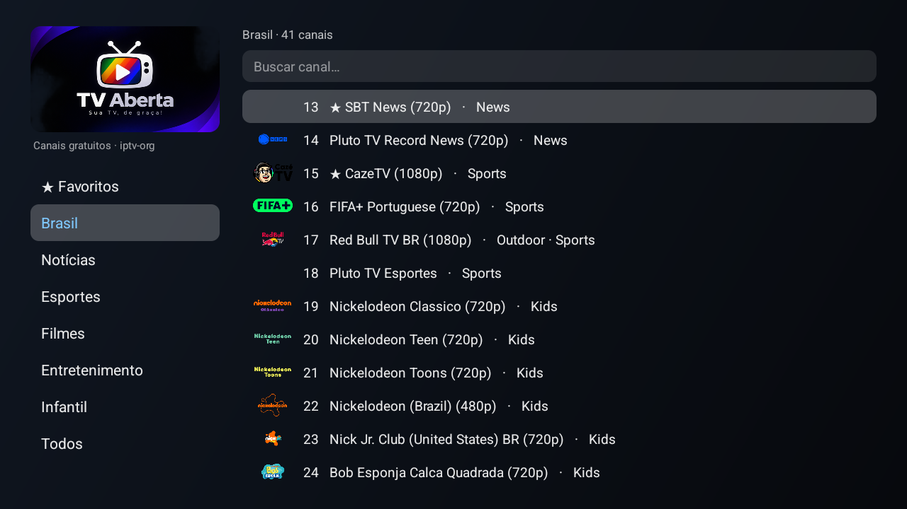
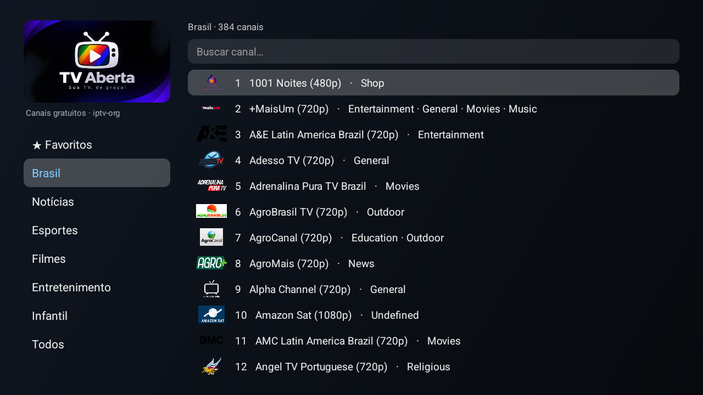
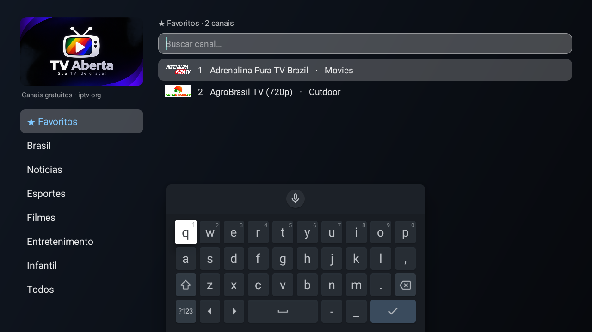

<p align="center"></p>

<h1 align="center">TV Aberta</h1>
<p align="center"><b>Sua TV, de graça!</b> Canais abertos e gratuitos para Android TV, leve e feito para o controle remoto.</p>



## O que faz

- **Só canais grandes**, do mais famoso para o menos famoso:
  - **Abertas nacionais:** SBT, Record, Band, RedeTV!, TV Cultura, TV Brasil, TV Gazeta.
  - **Jornalismo:** CNN Brasil, Jovem Pan News, BandNews, Record News, SBT News.
  - **Institucionais:** TV Câmara, TV Senado, TV Justiça.
  - **Esportes oficiais gratuitos:** CazéTV, FIFA+, Red Bull TV, Pluto TV Esportes, NBA TV.
  - **Infantil:** Nickelodeon, Bob Esponja, Turma da Mônica, Pluto TV Kids.
  - **Filmes e entretenimento:** canais do Pluto TV Brasil e a MTV Brasil.
  - **Notícias internacionais:** BBC, CNN International, DW, France 24, Al Jazeera.
- **Categorias:** ★ Favoritos, Brasil, Notícias, Esportes, Filmes, Entretenimento, Infantil e Todos.
- **★ Favoritos:** segure OK (ou aperte Menu) num canal.
- **Volta no último canal** sozinho ao abrir. Voltar mostra a lista.
- **Logos e números:** os canais têm logo e número. Digitar o número no controle pula para o canal, na lista e no player.
- **Busca** que ignora acentos: digitar uma letra no controle já leva à busca.
- **Player nativo do Android** (VideoView), com ↑/↓ ou Canal +/- para trocar. Em chips MediaTek, o VLC fica sem som; o player nativo, não.
- **Testa o canal antes de abrir.** Se ele não responder, o app avisa em vez de travar numa tela preta.
- **Leve:** um APK de ~300 KB, sem bibliotecas, feito para TVs com 1 GB de RAM.

| Logos e números | Favoritos |
|---|---|
|  |  |

## De onde vêm os canais

- **Listas públicas:** as do [iptv-org](https://github.com/iptv-org/iptv), que só reúnem transmissões públicas. A categoria Brasil soma também a lista do [iptv-com](https://github.com/iptv-com/iptv), sem repetir canais.
- **Cache:** as listas ficam guardadas por **12 horas**. Sem internet, o app usa a última lista salva.
- **Ficam de fora:**
  - canais marcados como **[Geo-blocked]**;
  - canais que usam **#KODIPROP** (DRM);
  - **canais pagos brasileiros** que só aparecem como retransmissão não oficial (Globo, ESPN, SporTV, Telecine, Combate, GloboNews...).
- **Cabeçalhos:** o app envia o **Referer** e o **User-Agent** das linhas `#EXTVLCOPT` quando o canal pede.

A ordem e o filtro de "famosos" estão em `Channels.java`, nas listas `FAME`, `FOREIGN` e `PAY_TV`.

## Integração com a tela inicial

O app informa o **último canal assistido** em `content://com.vizzion.tvaberta.last/channel` (só o nome, somente leitura). A tela inicial do projeto [tv-vizzion](https://github.com/anthonymb1204/tv-vizzion) usa isso no botão **▶ Continuar**.


## Compilar e instalar

Requisitos: **JDK 21** e o **Android SDK** com `platforms;android-34`, `build-tools;34.0.0` e `build-tools;35.0.0`. Não usa Gradle.

```bash
./build.sh                                   # gera out/tvaberta.apk
adb connect <IP-da-TV>:5555
adb install -r out/tvaberta.apk
```

- **Caminhos:** se o SDK ou o JDK estiverem em outro lugar, defina `ANDROID_HOME` e `JDK_BIN`.
- **Chave de assinatura:** o primeiro build cria a chave `key.jks`, que **não vai para o git**. Guarde essa chave: atualizar o app instalado exige a mesma chave.

## Estrutura

```
src/com/vizzion/tvaberta/
  MainActivity.java         categorias, lista, busca, favoritos, logos, números
  PlayerActivity.java       player em tela cheia, troca de canal, retomada
  Channels.java             download, cache, leitura do M3U, ranking e filtros
  LastChannelProvider.java  último canal para a tela inicial
res/drawable/               ícone e banner
docs/                       prints e arte original do logo
```

Requer Android 5.0 ou mais novo (testado numa F VIZZION TV com Android 14).
